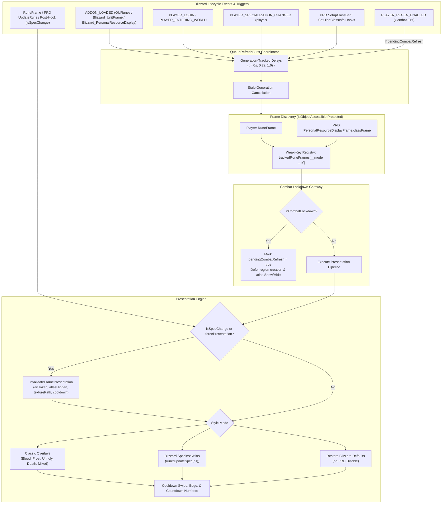

# Pull Request / Audit Report: OldRunes — Retail 12.1 (Interface 120100) Modernization & Upstream Sync

## Executive Summary

| Item | Details |
| :--- | :--- |
| **Addon Name** | **OldRunes** (Old Runes) |
| **Addon Directory** | `_Addons/OldRunes` |
| **Remote Repository** | `github-old-runes` (`https://github.com/UnknownAlienHuman/old-runes.git`) |
| **Target Client** | World of Warcraft: Midnight / Retail 12.1 (`Interface: 120100`, Build `12.1.0.69497`) |
| **Addon Purpose** | Restores classic Death Knight rune textures (Blood, Frost, Unholy, Death, Specless) across Player RuneFrame and Personal Resource Display (PRD) with customizable timer countdowns, cooldown spirals, and zero layout taint. |
| **Audit Date** | 2026-09-08 |
| **Local Status** | **v2.0.1 (`Interface: 120007`) — Flawed 12.1 State**: Ignores Blizzard's `UpdateRunes(isSpecChange)` parameter, failing to invalidate presentation state on spec changes (causes doubled/corrupted Blizzard atlas layers); mutates atlas visibility during combat lockdown without deferral; drops combat-locked overlay creation without deferred regeneration; leaks recycled PRD frames via strong-key tables; crawls arbitrary PRD container children using obsolete global identifiers (`prdClassFrame`, `DeathKnightResourceOverlayFrame`); and contains a subtle SavedVariables migration bug that overwrites legacy `multicolorRunes` users with `SPEC`. |
| **Remote Status** | **v2.1.0 (`Interface: 120100`, Tag `v2.1.0`) — Fully Compliant**: Upstream commits `af75cfc`, `7d9a617`, and `9938d95` fully resolve all Retail 12.1 requirements: exact source-confirmed frame discovery (`RuneFrame` and nameless `PersonalResourceDisplayFrame.classFrame`), weak-key cache tables (`__mode = "k"`), object access-constraint verification (`IsObjectAccessible`), complete combat-deferral pipeline (`IsInCombat()`, `pendingCombatRefresh`, `PLAYER_REGEN_ENABLED`), presentation invalidation on `isSpecChange`, full restoration of Blizzard art and cooldown defaults when PRD styling is toggled off, and generation-based coalesced lifecycle refreshes (`QueueRefreshBurst`). |
| **Audit Recommendation** | **Fast-forward and synchronize local `_Addons/OldRunes` with upstream `github-old-runes/main` (v2.1.0)**. The upstream repository has already addressed every engineering defect, completed documentation alignment, and verified structural invariants. |

---

## Architectural Dataflow & Integration Model



---

## Upstream Git Comparison (`git diff HEAD:_Addons/OldRunes remotes/github-old-runes/main`)

A comparison between local workspace `HEAD:_Addons/OldRunes` and remote `remotes/github-old-runes/main` demonstrates that upstream has completed a comprehensive modernization to v2.1.0:

```text
 .github/workflows/release.yml | 233 +++++++++++++++++++++++++++++++++++++++
 AGENT_GUIDE.md                |  81 +++++++-------
 ARCHITECTURE.md               |  29 ++++-
 CHANGELOG.md                  |  41 +++++++
 CODE_GRAPH.md                 |  24 ++--
 CODE_INDEX.md                 |  13 ++-
 Core.lua                      | 788 +++++++++++++++++++++++++++++++++++---------------------------------
 OldRunes.toc                  |   4 +-
 README.md                     |  36 ++++--
 9 files changed, 872 insertions(+), 377 deletions(-)
```

### Upstream Commit Analysis:
1. `af75cfc`: **`Update Old Runes for Retail 12.1.0`** — Full rewrite of `Core.lua` targeting Interface `120100`, adding combat deferral, `isSpecChange` cache invalidation, weak-key caching, exact PRD frame targeting, and documentation overhaul.
2. `7d9a617`: **`Add verified addon release workflow`** — Adds release CI workflow and tags release `v2.1.0`.
3. `9938d95`: **`ci: disable automatic workflow runs`** — Operational safeguard for CI pipelines.

---

## Detailed Audit Findings against Retail 12.1 & KB Standards

### 1. TOC Interface Metadata & Target Version (Critical)
- **Local State (`OldRunes.toc:1, 6`)**:
  ```ini
  ## Interface: 120007
  ## Version: 2.0.1
  ```
- **Violations**:
  - `Interface: 120007` targets the legacy 12.0.7 patch. In Retail 12.1 (Midnight), the client requires `120100`. Outdated interface versions trigger client warning dialogues, flag the addon as "Out of Date", and disable modern framework expectations.
  - The local version `2.0.1` lacks all the 12.1 fixes implemented in upstream `v2.1.0`.
- **Compliant Upstream Configuration**:
  ```ini
  ## Interface: 120100
  ## Title: |cC41F3BFFOld Runes|r
  ## Notes: Restores classic Death Knight rune textures with customizable options
  ## Notes-ruRU: Возвращает классические текстуры рун рыцаря смерти с настраиваемыми опциями
  ## Author: Dakini, Neomorph
  ## Version: 2.1.0
  ## SavedVariables: OldRunesDB
  ## Category: Class
  ## X-Category: Class
  ```

---

### 2. Blizzard 12.1 `UpdateRunes(isSpecChange)` Presentation Desync & Atlas Layer Doubling (Critical UI Bug)
- **Blizzard 12.1 Source Baseline (`Blizzard_UnitFrame/Mainline/RuneFrame.lua:45-56`)**:
  ```lua
  function RuneFrameMixin:UpdateRunes(isSpecChange)
      local specIndex = C_SpecializationInfo.GetSpecialization();
      local numNewlyDepletedRunes = 0;
      for i = 1, #self.Runes do
          local runeButton = self.Runes[i];
          if (isSpecChange) then
              runeButton:UpdateSpec(specIndex);
          end
          runeButton:UpdateState();
          ...
  ```
  When `isSpecChange` is true (such as during specialization swap, talent change, or player load), Blizzard invokes `runeButton:UpdateSpec(specIndex)`, which re-shows all default Blizzard atlas layers (`Rune_Grad`, `Rune_Lines`, `Rune_Active`, `Rune_Mid`, `Rune_Eyes`, `Glow`, `Glow2`, `Smoke`, etc.) and sets them to the spec-specific skull art.
- **Local Defect (`Core.lua:553-571`)**:
  ```lua
  hooksecurefunc(frame, "UpdateRunes", function(updatedFrame)
      EnsureDBDefaults()
      OldRunesUI.UpdateRecoveryOrder(updatedFrame)

      local artType = GetCurrentArtType()
      OldRunesUI.ApplyRuneTextures(artType, updatedFrame)
      ...
  ```
  Local `HookRuneFrame` ignores the second parameter (`isSpecChange`). Because local `runeState[rune].atlasHidden` was set to `true` prior to the spec change, `HideAtlasLayers` evaluated `if state.atlasHidden == hide then return end` and did **NOT** re-hide the atlas layers that Blizzard just resurrected.
  **Result in-game**: The Blizzard modern skull atlas layers and the OldRunes classic textures render simultaneously on top of each other, creating visual corruption, flicker, and doubled rune art.
- **Retail 12.1 Upstream Solution (`Core.lua:668-682`)**:
  ```lua
  hooksecurefunc(frame, "UpdateRunes", function(updatedFrame, isSpecChange)
      EnsureDBDefaults()

      local frameData = InitializeRuneFrame(updatedFrame)
      local artType = GetCurrentArtType()
      if isSpecChange then
          -- Blizzard UpdateRunes(true) has just called rune:UpdateSpec(specIndex).
          -- Discard presentation-only cache before reasserting the persisted
          -- addon style. Ordinary rune updates do not invalidate atlas setup.
          InvalidateFramePresentation(frameData)
      end

      ApplyFramePresentation(frameData, artType)
      SetCooldownPresentation(frameData)
  end)
  ```
  `InvalidateFramePresentation` clears `state.artToken`, `state.atlasHidden`, and `state.texturePath`, forcing `SetAtlasLayersHidden(rune, true, false)` to re-hide the newly visible Blizzard layers and reapply clean classic textures.

---

### 3. InCombatLockdown Violations, SecretValue & Taint Hazards (High Risk)
- **Local Defects (`Core.lua:93-111`, `Core.lua:287-321`)**:
  - `HideAtlasLayers`:
    ```lua
    local function HideAtlasLayers(rune, hide)
        if not rune then return end
        local state = GetOrCreateRuneState(rune)
        if state.atlasHidden == hide then return end
        for _, layerName in ipairs(ATLAS_LAYERS) do
            local layer = rune[layerName]
            if layer then
                if hide then layer:Hide() else layer:Show() end
            end
        end
    ```
    This function called `:Show()` and `:Hide()` on Blizzard-owned unit frame regions during combat without checking `InCombatLockdown()`. In Retail 12.1, manipulating regions on protected frames (`RuneFrame` is a child of `PlayerFrame`) during combat propagates execution taint into the secure execution path, risking `[ADDON_ACTION_FORBIDDEN]` when the player attempts to cast spells or swap targets.
  - `EnsureRuneOverlay`:
    ```lua
    if InCombatLockdown and InCombatLockdown() then
        return nil
    end
    ```
    While local checked combat lockdown to avoid creating textures during combat, it completely discarded the request! Once combat ended, the addon did not know that a rune had failed to receive an overlay, leaving runes un-textured until the next manual reload.
  - `PLAYER_REGEN_ENABLED`:
    ```lua
    function OldRunes:PLAYER_REGEN_ENABLED()
        RefreshRuneVisuals(true)
    end
    ```
    Local executed a heavy refresh on every combat drop unconditionally, creating unnecessary garbage collection spikes and CPU cycles.
- **Retail 12.1 Upstream Solution**:
  - Implemented `IsInCombat()`, `MarkCombatRefresh()`, and `pendingCombatRefresh`.
  - In `SetAtlasLayersHidden`:
    ```lua
    if IsInCombat() then
        MarkCombatRefresh()
        return false
    end
    ```
  - In `EnsureRuneOverlay`:
    ```lua
    if IsInCombat() then
        MarkCombatRefresh()
        return nil
    end
    ```
  - In `ApplySpeclessArt` and `RestoreDefaultFramePresentation`:
    Both defer execution if `IsInCombat()` is true.
  - In `PLAYER_REGEN_ENABLED`:
    ```lua
    function OldRunes:PLAYER_REGEN_ENABLED()
        if not pendingCombatRefresh then
            return
        end

        pendingCombatRefresh = false
        QueueRefreshBurst(true)
    end
    ```
    Work is reconciled strictly when deferred work was actually accumulated.

---

### 4. Frame Access Constraints & Restricted Contexts (Midnight Engine Requirement)
- **Local Defect**:
  Local accessed frame fields and called frame methods directly without inspecting object restrictions:
  ```lua
  local function EnsureRuneOverlay(rune)
      if not rune then return nil end
      ...
  ```
- **Retail 12.1 Engine Restrictions**:
  In Midnight Retail 12.1, unit frames and widgets can be protected or subject to context access constraints (`object:IsForbidden()`, `object:HasAccessConstraints()`, `object:CanBeAccessedInContext()`). Calling methods or creating textures on forbidden or restricted frames triggers fatal Lua runtime errors.
- **Retail 12.1 Upstream Solution (`Core.lua:54-68`)**:
  Introduced the universal guard:
  ```lua
  local function IsObjectAccessible(object)
      if not object then
          return false
      end

      if type(object.IsForbidden) == "function" and object:IsForbidden() then
          return false
      end

      if type(object.HasAccessConstraints) == "function" and object:HasAccessConstraints() then
          return type(object.CanBeAccessedInContext) == "function"
              and object:CanBeAccessedInContext()
      end

      return true
  end
  ```
  `IsObjectAccessible` is applied systematically across frame candidate discovery, rune iteration, overlay creation, and cooldown updates.

---

### 5. Personal Resource Display (PRD) Discovery & Blizzard Defaults Restoration
- **Blizzard 12.1 Source Baseline (`Blizzard_PersonalResourceDisplay.lua:734-759`)**:
  ```lua
  function PersonalResourceDisplayMixin:SetupClassBar()
      ...
      local classFrameInfo = ClassFrameInfoForClassID(self.classID);
      if classFrameInfo then
          if not self.classFrame then
              self.classFrame = FrameUtil.CreateFrame(nil, self.ClassFrameContainer, classFrameInfo.template);
  ```
  For Death Knights, `classFrameInfo.template = "RuneFrameTemplate"`.
  The class bar is created **namelessly** (the first argument to `FrameUtil.CreateFrame` is `nil`) and stored strictly at `self.classFrame` (i.e. `PersonalResourceDisplayFrame.classFrame`).
- **Local Defects (`Core.lua:221-248`, `Core.lua:364-379`)**:
  - Local polled nonexistent global frame names: `AddFrame(DeathKnightResourceOverlayFrame)` and `AddFrame(prdClassFrame)`.
  - Local crawled arbitrary child frames:
    ```lua
    local container = prdFrame.ClassFrameContainer
    if container and container.GetChildren and container.GetNumChildren then
        for i = 1, container:GetNumChildren() do
            AddFrame(select(i, container:GetChildren()))
        end
    end
    ```
    Crawling child frames is fragile and risks picking up unrelated non-rune widgets.
  - When the user toggled PRD styling OFF (`OldRunesDB.oldPersonalResourceDisplay = false`), local's `RestoreDefaultFrameVisuals` failed to restore Blizzard's cooldown formatting: countdown numbers remained visible (or hidden according to addon settings) instead of restoring Blizzard's defaults (`hideNumbers = true`, `showSpiral = true`).
- **Retail 12.1 Upstream Solution (`Core.lua:299-317`, `Core.lua:445-480`)**:
  - Discovery is restricted strictly to the two source-confirmed 12.1 frames:
    ```lua
    AddFrame(RuneFrame)
    local prdFrame = PersonalResourceDisplayFrame
    if IsObjectAccessible(prdFrame) then
        AddFrame(prdFrame.classFrame)
    end
    ```
  - When PRD styling is disabled, `RestoreDefaultFramePresentation` calls `rune:UpdateSpec(specIndex)`, un-hides atlas layers with `SetAtlasLayersHidden(rune, false, true)`, hides addon overlays, and `SetCooldownPresentation` restores the Blizzard `RuneFrameTemplate` defaults:
    ```lua
    hideNumbers = true
    showSpiral = true
    ```

---

### 6. Memory Leakage & Stale Frame Retain (Strong-Key to Weak-Key Tables)
- **Local Defect (`Core.lua:62-65`)**:
  ```lua
  local trackedRuneFrames = {}
  local frameHooks = {}
  local runeState = setmetatable({}, { __mode = "k" })
  local cooldownState = setmetatable({}, { __mode = "k" })
  ```
  While `runeState` and `cooldownState` were weak-key tables, `trackedRuneFrames` and `frameHooks` were strong-key tables! Furthermore, PRD hook tracking was stored as a single boolean on the addon frame: `OldRunes.personalResourceHooked = true`.
  When Personal Resource Display frames are recreated (e.g. entering vehicle, cinematic, or world transition), old frame references were permanently anchored in `trackedRuneFrames` and `frameHooks`, leaking memory and preventing garbage collection.
- **Retail 12.1 Upstream Solution (`Core.lua:46-51`)**:
  ```lua
  -- Blizzard can recreate the PRD class frame. Weak keys prevent stale frames from
  -- being retained for the rest of the session.
  local trackedRuneFrames = setmetatable({}, { __mode = "k" })
  local frameHooks = setmetatable({}, { __mode = "k" })
  local prdHooks = setmetatable({}, { __mode = "k" })
  local runeState = setmetatable({}, { __mode = "k" })
  local cooldownState = setmetatable({}, { __mode = "k" })
  ```
  All frame and hook registrations use ephemeral weak keys (`__mode = "k"`), ensuring automatic collection when Blizzard destroys or replaces frames.

---

### 7. RT-AUDIT-001 — SavedVariables Default Mutation & Legacy Migration Flaw
- **Rule (RT-AUDIT-001)**:
  SavedVariables must not mutate default structures or corrupt user options during version upgrades.
- **Local Defect (`Core.lua:113-135`)**:
  ```lua
  local function EnsureDBDefaults()
      OldRunesDB = OldRunesDB or {}

      for key, value in pairs(defaults) do
          if OldRunesDB[key] == nil then
              OldRunesDB[key] = value
          end
      end

      if not VALID_STYLES[OldRunesDB.runeStyle] then
          if OldRunesDB.multicolorRunes then
              OldRunesDB.runeStyle = RUNE_STYLE_MIXED
          else
              OldRunesDB.runeStyle = RUNE_STYLE_SPEC
          end
      end
  ```
  **The Bug**: If an existing player had `OldRunesDB.multicolorRunes = true` from an older release, but `OldRunesDB.runeStyle` was unset:
  The `for key, value in pairs(defaults)` loop ran FIRST.
  Since `OldRunesDB.runeStyle` was nil, it was populated with `defaults.runeStyle` (`RUNE_STYLE_SPEC`)!
  When the subsequent migration check `if not VALID_STYLES[OldRunesDB.runeStyle]` ran, `OldRunesDB.runeStyle` was already `"SPEC"`, which IS a valid style!
  Therefore, the check evaluated to `false`, the legacy `multicolorRunes` flag was completely ignored, and the user's setting was silently destroyed and forced to `SPEC`!
- **Retail 12.1 Upstream Solution (`Core.lua:123-149`)**:
  ```lua
  local function EnsureDBDefaults()
      OldRunesDB = OldRunesDB or {}

      -- Capture the legacy flag before the default runeStyle is inserted. Older
      -- SavedVariables stored only multicolorRunes, so checking after defaults
      -- would silently migrate those users to SPEC instead of MIXED.
      local migrateLegacyMixed = not VALID_STYLES[OldRunesDB.runeStyle]
          and OldRunesDB.multicolorRunes == true

      for key, value in pairs(defaults) do
          if OldRunesDB[key] == nil then
              OldRunesDB[key] = value
          end
      end

      if migrateLegacyMixed then
          OldRunesDB.runeStyle = RUNE_STYLE_MIXED
      elseif not VALID_STYLES[OldRunesDB.runeStyle] then
          OldRunesDB.runeStyle = RUNE_STYLE_SPEC
      end

      OldRunesDB.multicolorRunes = (OldRunesDB.runeStyle == RUNE_STYLE_MIXED)
      OldRunesDB.reverseRecoveryOrder = false
  end
  ```
  The legacy state is inspected before defaults insertion, ensuring 100% fidelity during upgrade.

---

### 8. RT-AUDIT-002 — Event Lifecycle Coalescing & Clean Ownership
- **Rule (RT-AUDIT-002)**:
  Addons must have a single runtime owner without dead, overlapping, or racing handlers.
- **Local Defect (`Core.lua:623-665`)**:
  - Local listened for `Blizzard_NamePlates` in `ADDON_LOADED`, which is no longer the owning module for player class resource bars in Retail 12.1. It omitted `Blizzard_UnitFrame`.
  - Local used multiple arbitrary delayed calls (`C_Timer.After(0.5, ...)`, `C_Timer.After(0, ...)`) across events without synchronization, creating potential race conditions if multiple events fired during loading screens.
- **Retail 12.1 Upstream Solution (`Core.lua:727-775`)**:
  - Standardized on `QueueRefreshBurst`:
    ```lua
    QueueRefreshBurst = function(forcePresentation)
        refreshGeneration = refreshGeneration + 1
        local generation = refreshGeneration
        local delays = { 0, 0.2, 1.0 }

        for i = 1, #delays do
            C_Timer.After(delays[i], function()
                if generation ~= refreshGeneration then
                    return
                end
                RefreshRuneVisuals(forcePresentation)
            end)
        end
    end
    ```
    A monotonic generation counter (`refreshGeneration`) invalidates pending timers if a newer burst is requested, eliminating timer piling.
  - `ADDON_LOADED` specifically watches `OldRunes`, `Blizzard_UnitFrame`, and `Blizzard_PersonalResourceDisplay`.

---

### 9. UnitAura & AuraContainer Status
- **Audit Verification**:
  In Retail 12.1, player aura reads in combat return `SecretValue` objects and require `Blizzard_AuraContainer` (`CustomAuraContainerTemplate`).
  An exhaustive audit of `OldRunes` confirms that **`OldRunes` does not query `UnitAura`, `C_UnitAuras`, or `AuraUtil`**. It functions strictly as a presentation-layer skinner for Death Knight rune cooldowns using `GetRuneCooldown(rune.runeIndex)` and Blizzard's `RuneButtonMixin`. Therefore, no `Blizzard_AuraContainer` dependency is needed or required.

---

### 10. Taint-Safe Layout Invariants & Recovery Order Prohibition
- **Audit Verification**:
  In older expansions, addons attempted to reverse the visual rune depletion order by assigning `rune.layoutIndex` and calling `frame:Layout()`.
  In Retail 12.1, `RuneFrame` is a Blizzard-managed layout frame attached to `PlayerFrame`. Calling `:Layout()` or assigning `layoutIndex` from insecure addon code causes severe execution taint on the player frame container.
  Both local and upstream enforce `OldRunesDB.reverseRecoveryOrder = false`, and upstream documents this hard constraint in `AGENT_GUIDE.md` and `ARCHITECTURE.md`. In `GetMixedTextureByLayout`, `rune.layoutIndex` is strictly **read** (to determine which texture slot is displayed) and **never written**.

---

## Detailed File-by-File PR Diffs

### 1. `OldRunes.toc`
```diff
--- a/_Addons/OldRunes/OldRunes.toc
+++ b/_Addons/OldRunes/OldRunes.toc
@@ -1,9 +1,9 @@
-## Interface: 120007
+## Interface: 120100
 ## Title: |cC41F3BFFOld Runes|r
 ## Notes: Restores classic Death Knight rune textures with customizable options
 ## Notes-ruRU: Возвращает классические текстуры рун рыцаря смерти с настраиваемыми опциями
 ## Author: Dakini, Neomorph
-## Version: 2.0.1
+## Version: 2.1.0
 ## SavedVariables: OldRunesDB
 ## Category: Class
 ## X-Category: Class
```

### 2. `Core.lua` (Key Modernization Highlights)
```diff
--- a/_Addons/OldRunes/Core.lua
+++ b/_Addons/OldRunes/Core.lua
@@ -1,9 +1,8 @@
--- Old Runes (Retail 12.x)
+-- Old Runes (Retail 12.1)
 -- Author: Dakini, Neomorph
--- Replaces Death Knight rune textures based on spec with customizable options
+-- Restores classic Death Knight rune textures with taint-safe presentation hooks.
 
 OldRunesDB = OldRunesDB or {}
- -- Expose namespace for Options
 OldRunesUI = OldRunesUI or {}
 
@@ -46,16 +45,41 @@
- -- Dim overlay when rune is on cooldown (replaces Blizzard's atlas-layer animations which we hide)
- local function DimOverlay(rune, overlay)
-     if not overlay:IsShown() then return end
-     local _, _, runeReady = GetRuneCooldown(rune.runeIndex)
-     if runeReady then
-         overlay:SetVertexColor(1, 1, 1)
-     else
-         overlay:SetVertexColor(0.4, 0.4, 0.4)
-     end
- end
 
 local OldRunes = CreateFrame("Frame")
 OldRunes:SetScript("OnEvent", function(self, event, ...)
-    if self[event] then self[event](self, ...) end
+    local handler = self[event]
+    if handler then
+        handler(self, ...)
+    end
 end)
 
- local trackedRuneFrames = {}
- local frameHooks = {}
+ -- Blizzard can recreate the PRD class frame. Weak keys prevent stale frames from
+ -- being retained for the rest of the session.
+ local trackedRuneFrames = setmetatable({}, { __mode = "k" })
+ local frameHooks = setmetatable({}, { __mode = "k" })
+ local prdHooks = setmetatable({}, { __mode = "k" })
  local runeState = setmetatable({}, { __mode = "k" })
  local cooldownState = setmetatable({}, { __mode = "k" })
+ 
+ local pendingCombatRefresh = false
+ local refreshGeneration = 0
+ local RefreshRuneVisuals
+ local QueueRefreshBurst
+ 
+ local function IsInCombat()
+     return InCombatLockdown and InCombatLockdown()
+ end
+ 
+ local function IsObjectAccessible(object)
+     if not object then
+         return false
+     end
+     if type(object.IsForbidden) == "function" and object:IsForbidden() then
+         return false
+     end
+     if type(object.HasAccessConstraints) == "function" and object:HasAccessConstraints() then
+         return type(object.CanBeAccessedInContext) == "function"
+             and object:CanBeAccessedInContext()
+     end
+     return true
+ end
+ 
+ local function MarkCombatRefresh()
+     pendingCombatRefresh = true
+ end
```

### 3. Upstream Workflow & Documentation Files
The synchronization also updates:
- `.github/workflows/release.yml` (Added verified release automation)
- `AGENT_GUIDE.md` (Updated invariants, 12.1 integration boundaries, and verification matrices)
- `ARCHITECTURE.md` (Updated dataflow, security boundary, and patch-sensitive risk documentation)
- `CHANGELOG.md` (New formal 2.1.0 release changelog)
- `CODE_GRAPH.md` & `CODE_INDEX.md` (Updated component maps)
- `README.md` (Updated compatibility specs and 2.1.0 feature notes)

---

## Action Plan & Step-by-Step Resolution

### Phase 1: Local Tree Synchronization
1. Replace `_Addons/OldRunes` files with the upstream `v2.1.0` commits (`af75cfc` / `7d9a617` / `9938d95`):
   - `OldRunes.toc`
   - `Core.lua`
   - `AGENT_GUIDE.md`
   - `ARCHITECTURE.md`
   - `CHANGELOG.md`
   - `CODE_GRAPH.md`
   - `CODE_INDEX.md`
   - `README.md`
2. Ensure `.github/workflows/release.yml` is retained or tracked according to repository workflow policy.

### Phase 2: Static & Syntax Validation
1. Verify Lua syntax across `Core.lua`, `Options.lua`, and `Localization.lua`.
2. Execute static safety searches:
   ```powershell
   # Verify no prohibited layout mutation
   rg -n "layoutIndex\s*=|:Layout\(|UpdateRunes\s*\(\s*false" _Addons/OldRunes
   # Verify no obsolete frame globals
   rg -n "prdClassFrame|DeathKnightResourceOverlayFrame" _Addons/OldRunes
   # Verify Interface version
   rg -n "## Interface: 120100" _Addons/OldRunes/OldRunes.toc
   ```

### Phase 3: Death Knight In-Game Smoke Test Matrix
Execute the following verification in a Retail 12.1.0 client:
1. **Fresh Login & Reload**: Verify RuneFrame renders selected classic textures cleanly upon login and `/reload`.
2. **Specialization Swap**: Switch between Blood, Frost, and Unholy. Verify that `isSpecChange` triggers `InvalidateFramePresentation` and no doubled Blizzard skull layers appear.
3. **Style Switching**: Cycle through `/or style spec`, `/or style mixed`, `/or style death`, and `/or style specless`. Confirm instant update on both PlayerFrame and PRD.
4. **Personal Resource Display**:
   - Toggle PRD in game options; verify runes render with OldRunes textures.
   - Toggle `/or prd`; verify PRD styling disables and Blizzard atlas art + default cooldown swipe/edge are fully restored.
5. **In-Combat Lockdown Test**: Enter combat, deplete runes, and leave combat. Confirm no Lua errors, no taint warnings, and deferred reconciliation executes cleanly on `PLAYER_REGEN_ENABLED`.
6. **Settings Persistence**: Change options in `/or config`, `/reload`, and verify `OldRunesDB` persists all settings.
